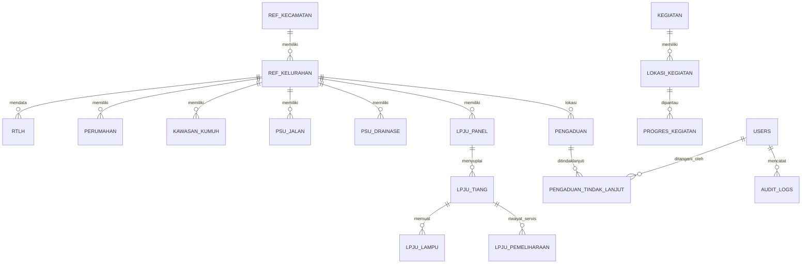
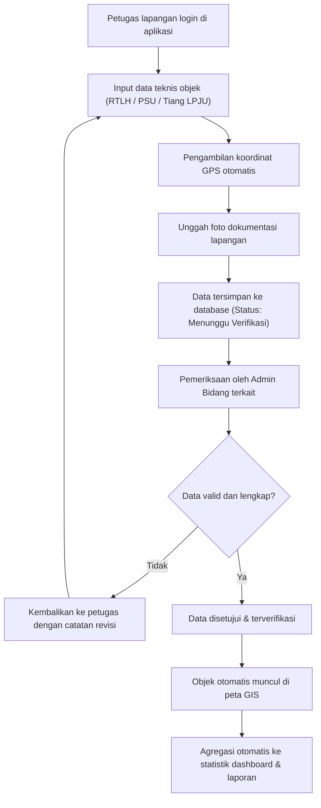
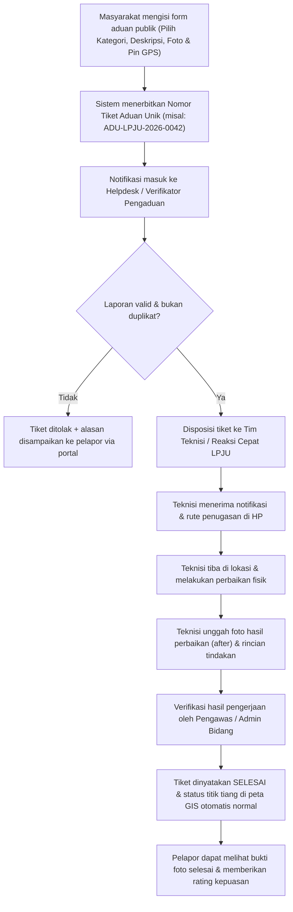

# BLUEPRINT APLIKASI WEB GIS DINAS PERKIM KOTA JAMBI

**Rancangan Konseptual Web GIS + Database Spasial**

Saya merekomendasikan pembangunan aplikasi bernama:
**SIMPERKIM KOJA** (Sistem Informasi Perumahan dan Kawasan Permukiman Kota Jambi)

Aplikasi ini dirancang sebagai pusat data digital Dinas Perumahan dan Kawasan Permukiman Kota Jambi yang mengintegrasikan data sektoral, peta geografis, pendataan lapangan, monitoring kegiatan, dan pelayanan informasi kepada masyarakat.

Konsep utamanya adalah **satu database, satu peta digital, banyak modul pelayanan dan pengelolaan data**. Aplikasi tidak hanya menjadi website yang menampilkan peta, tetapi menjadi sistem manajemen data Perkim yang dapat digunakan untuk mendukung perencanaan, penganggaran, pelaksanaan pembangunan, monitoring, dan evaluasi.

---

## 1. Konsep dan Tujuan Aplikasi

**Tujuan utama:**

1. Mengintegrasikan seluruh data bidang urusan Perkim dalam satu sistem terpadu.
2. Menyediakan database spasial berbasis koordinat dan batas wilayah administrasi Kota Jambi.
3. Mengetahui persebaran perumahan dan infrastruktur permukiman di Kota Jambi.
4. Memudahkan pendataan, verifikasi, dan inventarisasi kondisi riil di lapangan.
5. Mengelola data aset dan jaringan Lampu Penerangan Jalan Umum (LPJU) serta memantau status operasionalnya (menyala, padam, rusak).
6. Menyediakan sistem layanan pengaduan masyarakat yang cepat tanggap berbasis tiket dan geolokasi untuk perbaikan fasilitas permukiman dan lampu jalan.
7. Memantau progres kegiatan pembangunan fisik dan pemeliharaan secara geografis.
8. Menyediakan informasi publik yang transparan dan dapat diakses masyarakat luas.
9. Mendukung pengambilan keputusan perencanaan dan penganggaran berbasis data spasial yang valid (_evidence-based policy_).

## 2. Struktur Menu Aplikasi

Saya menyarankan aplikasi memiliki sebelas modul utama:

- **01. Dashboard Eksekutif:** Statistik ringkas, grafik tren, indikator capaian Perkim, status kondisi LPJU, dan rekapitulasi pengaduan.
- **02. Data Perumahan:** Perumahan formal, swadaya, pengembang (_developer_), dan serah terima PSU perumahan.
- **03. Data Kawasan Permukiman:** Profil kawasan permukiman, daya dukung lingkungan, dan tipologi permukiman.
- **04. Rumah Tidak Layak Huni (RTLH):** Pendataan fisik rumah, kriteria kelayakan, verifikasi lapangan, dan riwayat bantuan penanganan.
- **05. Kawasan Kumuh:** Delineasi kawasan kumuh (SK Kumuh), penilaian indikator kekumuhan, dan monitoring penanganan.
- **06. Prasarana, Sarana dan Utilitas (PSU):** Jaringan jalan lingkungan, saluran drainase, sanitasi, dan fasilitas sosial/umum kawasan permukiman (di luar LPJU utama).
- **07. Lampu Penerangan Jalan Umum (LPJU):** Inventarisasi titik tiang LPJU, panel kontrol/APP, ID Pelanggan PLN, jenis lampu (LED, Son-T, Solar Cell), kapasitas daya (Watt), status lampu (menyala/padam/rusak), serta jadwal dan riwayat pemeliharaan berkala.
- **08. Layanan Pengaduan & Aspirasi Masyarakat:** Kanal pelaporan warga (LPJU padam, kerusakan jalan lingkungan, saluran tersumbat, dsb.) berbasis tiket digital (_ticketing system_), penandaan lokasi GPS (_geotagging_), verifikasi foto sebelum-sesudah (_before-after_), serta pelacakan status penanganan secara terbuka.
- **09. Pertanahan dan Aset:** Lokasi bidang tanah, luas, status legalitas/sertifikasi, dan aset terkait Dinas Perkim.
- **10. Program dan Kegiatan:** Lokasi paket pekerjaan, alokasi anggaran, kontraktor pelaksana, kurva S, dan riwayat progres fisik.
- **11. Peta GIS dan Laporan Tematik:** Pemetaan multi-layer interaktif, analisis spasial (_buffer_ radius pencahayaan LPJU, analisis kekumuhan), serta ekspor laporan berkala (PDF/Excel/GeoJSON).

_Modul administrasi juga diperlukan untuk mengatur akun pengguna, hak akses bertingkat, master referensi data, audit trail/log aktivitas, dan konfigurasi sistem._

## 3. Desain Peta Interaktif GIS

Ini merupakan bagian paling penting dari SIMPERKIM KOJA. Peta harus mampu menampilkan beberapa jenis informasi sekaligus.

### Layer Peta

| Layer peta                 | Bentuk data   | Keterangan                                                              |
| -------------------------- | ------------- | ----------------------------------------------------------------------- |
| Batas kecamatan            | Polygon       | 11 kecamatan di Kota Jambi                                              |
| Batas kelurahan            | Polygon       | 68 kelurahan di Kota Jambi                                              |
| Lokasi rumah/RTLH          | Point         | Titik koordinat penerima bantuan rumah                                  |
| Kawasan perumahan          | Polygon       | Batas tapak dan sebaran perumahan                                       |
| Kawasan permukiman         | Polygon       | Batas delineasi kawasan permukiman                                      |
| Kawasan kumuh              | Polygon       | Batas kawasan kumuh sesuai SK Walikota                                  |
| Jalan lingkungan           | Line          | Jaringan jalan lingkungan permukiman                                    |
| Drainase                   | Line          | Saluran drainase lingkungan                                             |
| Sanitasi                   | Point/Line    | Sarana sanitasi komunal dan saluran pembuangan                          |
| PSU dan fasilitas umum     | Point         | Fasos, fasum, dan sarana lingkungan permukiman                          |
| Titik tiang LPJU           | Point         | Titik lokasi tiang lampu jalan, nomor seri/barcode, kondisi nyala/padam |
| Panel / KWH Meter LPJU     | Point         | Panel kontrol APP, gardu PLN, dan ID Pelanggan listrik                  |
| Jaringan kabel LPJU        | Line          | Jaringan distribusi kabel penerangan jalan (opsional)                   |
| Titik pengaduan masyarakat | Point         | Sebaran laporan aduan warga (ikon & warna sesuai status penanganan)     |
| Lokasi pekerjaan           | Point/Polygon | Titik/area proyek pembangunan dan pemeliharaan fisik                    |
| Aset tanah                 | Polygon       | Batas kepemilikan aset tanah pemkot/dinas                               |

**Fungsi peta yang harus tersedia:**

- Zoom, geser (_pan_), dan pencarian cepat (berdasarkan alamat, nomor tiang LPJU, atau nomor tiket aduan).
- Menampilkan dan menyembunyikan layer secara fleksibel (_layer toggle_).
- Filter bertingkat berdasarkan kecamatan, kelurahan, bidang teknis, dan status objek.
- Filter khusus LPJU: tampilkan seluruh lampu, lampu menyala normal, lampu padam, atau lampu yang sedang dalam antrean perbaikan.
- Filter dan visualisasi sebaran pengaduan masyarakat dengan indikator warna (_badge status_): Merah (Baru Masuk), Kuning (Dalam Penanganan), Hijau (Selesai).
- Peta panas (_Heatmap_) intensitas aduan warga untuk mengidentifikasi area rawan keluhan dan kawasan minim penerangan (_blind spot_).
- Analisis _buffer_ jangkauan penerangan (radius iluminasi standar per titik tiang LPJU untuk melihat jalan yang belum terlayani cahaya).
- Klik objek (_pop-up tooltip_) untuk melihat informasi detail, foto kondisi eksisting, dan histori pemeliharaan.
- Pengukuran jarak (_distance_) dan luas area (_area measurement_).
- Pengambilan koordinat lokasi interaktif (klik pada peta untuk mengisi koordinat saat input data atau pelaporan).
- Cetak peta tematik (PDF siap cetak dengan legenda, orientasi mata angin, dan skala otomatis).
- Ekspor data spasial (GeoJSON, KML, atau Shapefile).

### Legenda Peta

Legenda ditampilkan sebagai panel kecil di pojok kanan bawah peta. Legenda hanya memuat simbol dari layer yang sedang aktif.

| Simbol                | Arti                                                      |
| --------------------- | --------------------------------------------------------- |
| Garis batas poligon   | Batas administrasi Kota Jambi (sumber: `KabKota.geojson`) |
| Titik hijau (`#16a34a`) | Lampu LPJU menyala                                      |
| Titik merah (`#dc2626`) | Lampu LPJU padam                                        |

Layer lain (RTLH, kawasan kumuh, pengaduan) ditambahkan ke legenda saat layernya diaktifkan pada tahap berikutnya.

### Aturan Popup (Hover dan Klik)

| Objek                       | Hover (kursor di atas objek)                                   | Klik                                                                                  |
| --------------------------- | -------------------------------------------------------------- | ------------------------------------------------------------------------------------- |
| Titik lampu LPJU            | Tooltip kecil: kode tiang dan status. Hilang saat kursor keluar. | Popup: kode tiang, status, koordinat (lat, lng), dan tombol tutup. Titik yang dipilih diberi garis tepi tebal. |
| Poligon batas Kota Jambi    | Garis tepi sedikit lebih tebal (tanpa popup).                  | Popup: nama wilayah dan sumber data.                                                  |

Aturan tambahan:

- Pada perangkat sentuh, ketuk objek berfungsi sebagai pengganti klik. Hover tidak tersedia di perangkat sentuh, jadi informasi utama harus tetap bisa dibaca dari popup.
- Seluruh teks dari data (kode tiang, nama wilayah) di-escape sebelum ditampilkan agar aman dari XSS.
- Popup hanya menampilkan data publik. Data pribadi pelapor atau identitas petugas tidak ditampilkan.
- Pada tahap berikutnya, popup LPJU dapat ditambah foto kondisi, histori pemeliharaan, dan tiket aduan terkait, sesuai fungsi "Klik objek" di atas.

_Catatan: Saya menyarankan setiap objek memiliki identitas unik sehingga ketika data diubah, informasi pada peta ikut diperbarui._

## 4. Struktur Database

Untuk kebutuhan ini, saya merekomendasikan **PostgreSQL + PostGIS**. PostGIS merupakan ekstensi database yang memungkinkan penyimpanan dan pengolahan data geografis.

### Rancangan Tabel Awal

| Kelompok   | Nama tabel                | Isi data                                                                                                            |
| ---------- | ------------------------- | ------------------------------------------------------------------------------------------------------------------- |
| Referensi  | `ref_kecamatan`           | 11 kecamatan                                                                                                        |
| Referensi  | `ref_kelurahan`           | 68 kelurahan                                                                                                        |
| Perumahan  | `perumahan`               | Data kawasan perumahan                                                                                              |
| Perumahan  | `unit_rumah`              | Data unit rumah                                                                                                     |
| RTLH       | `rtlh`                    | Kondisi dan status rumah                                                                                            |
| Permukiman | `kawasan_permukiman`      | Profil kawasan                                                                                                      |
| Kumuh      | `kawasan_kumuh`           | Deliniasi dan indikator                                                                                             |
| PSU        | `psu_jalan`               | Jalan lingkungan                                                                                                    |
| PSU        | `psu_drainase`            | Saluran drainase                                                                                                    |
| PSU        | `psu_sanitasi`            | Infrastruktur sanitasi                                                                                              |
| PSU        | `psu_fasilitas`           | Fasilitas umum                                                                                                      |
| LPJU       | `lpju_panel`              | Panel APP, gardu distribusi, nomor KWH meter, dan ID Pelanggan PLN                                                  |
| LPJU       | `lpju_tiang`              | Titik koordinat tiang, nomor seri/barcode tiang, jenis/tinggi tiang, kondisi fisik                                  |
| LPJU       | `lpju_lampu`              | Tipe luminer (LED/Son-T/Solar), daya (Watt), merek, tahun pasang, status nyala/padam                                |
| LPJU       | `lpju_pemeliharaan`       | Log riwayat perbaikan, penggantian spare part, petugas teknisi, dan tanggal pengerjaan                              |
| Pengaduan  | `pengaduan`               | Tiket aduan warga, kategori aduan (LPJU padam/PSU rusak), identitas pelapor, koordinat GPS, foto awal, status tiket |
| Pengaduan  | `pengaduan_tindak_lanjut` | Catatan penanganan lapangan teknisi, tanggal respon, tindakan teknis, foto bukti penyelesaian, rating kepuasan      |
| Aset       | `aset_tanah`              | Data bidang tanah                                                                                                   |
| Kegiatan   | `kegiatan`                | Program dan anggaran                                                                                                |
| Kegiatan   | `lokasi_kegiatan`         | Lokasi pekerjaan                                                                                                    |
| Kegiatan   | `progres_kegiatan`        | Riwayat progres                                                                                                     |
| Dokumen    | `dokumen`                 | Foto, berkas dan dokumen pendukung                                                                                  |
| Sistem     | `users`                   | Akun pengguna                                                                                                       |
| Sistem     | `roles`                   | Hak akses                                                                                                           |
| Sistem     | `audit_logs`              | Riwayat aktivitas                                                                                                   |

### Relasi Database

Setiap tabel objek geografis juga memiliki kolom `geom` dengan tipe geometri yang sesuai, misalnya Point, LineString atau Polygon. Untuk konsistensi, gunakan sistem koordinat **SRID 4326** untuk penyimpanan koordinat geografis, dengan proyeksi yang sesuai saat menghitung luas atau jarak.

> **Catatan Penting:** Data penduduk, pemilik rumah, status tanah, serta identitas pelapor pengaduan (nomor telepon, NIK, alamat lengkap) harus dilindungi sesuai standar perlindungan privasi. Pada peta publik dan tracking tiket publik, identitas pelapor disamarkan (_masked_) dan nomor telepon hanya dapat dilihat oleh petugas helpdesk dan admin bidang yang berwenang memproses aduan.

## 5. Arsitektur Teknologi Aplikasi

Berikut susunan teknologi yang saya rekomendasikan:

- **FRONTEND — Aplikasi Web:** React.js / Next.js + Tailwind CSS, Leaflet / OpenLayers untuk peta
- **BACKEND — REST API:** Laravel + PHP (Autentikasi, validasi, proses data, laporan)
- **DATABASE:** PostgreSQL + PostGIS
- **FILE STORAGE:** Foto, dokumen, peta
- **INFRASTRUKTUR SERVER:** Linux + Nginx + SSL + Backup

### Rekomendasi Perangkat Lunak

| Komponen     | Teknologi       | Keterangan         |
| ------------ | --------------- | ------------------ |
| Frontend     | React / Next.js | Tampilan aplikasi  |
| Backend      | Laravel         | Pengelolaan sistem |
| Database     | PostgreSQL      | Penyimpanan data   |
| GIS database | PostGIS         | Data spasial       |
| Peta         | Leaflet         | Peta interaktif    |
| Peta dasar   | OpenStreetMap   | Basemap            |
| Grafik       | Apache ECharts  | Statistik          |
| Laporan      | PDF / Excel     | Ekspor data        |
| Server       | Linux VPS       | Hosting aplikasi   |

**Mengapa kombinasi ini?**

- Tidak wajib membeli lisensi ArcGIS.
- Dapat menggunakan data spasial dari QGIS.
- Bisa dikembangkan secara bertahap.
- Mendukung peta dengan banyak layer.
- Dapat diintegrasikan dengan aplikasi pemerintah daerah lainnya.

_Catatan: QGIS dapat digunakan oleh petugas untuk mengolah dan memvalidasi data peta sebelum dimasukkan ke database aplikasi._

## 6. Hak Akses Pengguna

Karena aplikasi akan digunakan oleh internal dinas, teknisi lapangan, dan masyarakat, hak akses dipisahkan menggunakan sistem _role-based access control_ (RBAC) yang ketat.

| Pengguna                          | Hak akses & Peran                                                                                                                                                      |
| --------------------------------- | ---------------------------------------------------------------------------------------------------------------------------------------------------------------------- |
| Super Admin                       | Mengelola konfigurasi teknis server, akun pengguna, hak akses peran, audit log, dan backup sistem                                                                      |
| Admin Dinas                       | Mengelola seluruh modul data Perkim, integrasi data antarbidang, dan validasi data tingkat kota                                                                        |
| Admin Bidang Teknis               | Mengelola data sektoral bidang masing-masing (Bidang Perumahan, Kawasan Permukiman, PSU, dan LPJU)                                                                     |
| Operator Helpdesk / Pengaduan     | Memverifikasi tiket pengaduan masuk dari warga, memvalidasi kelayakan laporan, dan mendisposisikan tiket ke bidang/teknisi terkait                                     |
| Tim Reaksi Cepat / Teknisi LPJU   | Menerima disposisi tugas perbaikan pada aplikasi mobile, input catatan tindakan teknis, mencatat penggantian spare part, dan mengunggah foto bukti perbaikan (_after_) |
| Operator Kecamatan                | Input, verifikasi, dan pemutakhiran data wilayah administratif di kecamatannya                                                                                         |
| Petugas Survei Lapangan           | Pendataan fisik di lapangan (survei RTLH, survei tiang LPJU, PSU) lengkap dengan koordinat dan foto                                                                    |
| Pimpinan (Kadis, Kabid, Walikota) | Memantau dashboard eksekutif, performa respon SLA aduan, status lampu jalan real-time, dan laporan capaian program                                                     |
| Masyarakat Umum                   | Mengakses peta publik, melaporkan kerusakan fasilitas / lampu padam dengan foto & geolokasi GPS, serta melacak status progres tiket aduan secara transparan            |

## 7. Alur Kerja Aplikasi

Aplikasi memiliki dua alur kerja utama: alur pendataan aset fisik internal dan alur responsif penanganan pengaduan masyarakat.

### A. Alur Pendataan dan Verifikasi Aset / RTLH

### B. Alur Layanan Pengaduan Masyarakat & Penanganan Teknis (LPJU & Fasilitas)

## 8. Desain Dashboard Utama

Dashboard dirancang adaptif dan menyajikan data berbasis visual grafis serta matriks spasial:

**1. Sektor Perumahan & Kawasan Permukiman:**

- Jumlah sebaran kawasan perumahan formal dan swadaya.
- Total unit rumah terdata dan persebaran RTLH (menunggu verifikasi, dalam proses, tertangani).
- Luas kawasan kumuh (Ha) dan grafik penurunan luas kawasan kumuh tahunan.
- Total panjang jalan lingkungan dan inventarisasi kondisi drainase.
- Rekapitulasi serah terima PSU perumahan dari pengembang.

**2. Sektor Lampu Penerangan Jalan Umum (LPJU):**

- Total populasi titik tiang LPJU se-Kota Jambi.
- Indikator status operasional: Jumlah lampu menyala normal vs padam / rusak / dalam perbaikan.
- Komposisi teknologi lampu: Persentase lampu hemat energi (LED) vs lampu konvensional (Son-T/Merkuri) vs Solar Cell.
- Akumulasi kapasitas daya terpasang (kVA / Watt) dan estimasi beban tagihan rekening listrik PJU bulanan.
- Sebaran panel kontrol APP dan nomor ID Pelanggan PLN per wilayah kecamatan.

**3. Sektor Layanan Pengaduan & Aspirasi Warga:**

- Rekapitulasi tiket pengaduan (harian, mingguan, bulanan).
- Komposisi status tiket: _Menunggu Verifikasi_, _Sedang Dikerjakan/Disposisi_, dan _Selesai_.
- Capaian SLA: Rata-rata waktu tanggap pertama (_response time_) dan waktu penyelesaian perbaikan (_resolution time_).
- Peta panas (_Heatmap_) intensitas aduan warga untuk mendeteksi kawasan rawan kerusakan dan minim penerangan jalan (_blank spot_).
- Skor indeks kepuasan masyarakat terhadap layanan perbaikan.

**4. Sektor Program & Kegiatan Pembangunan:**

- Jumlah paket kegiatan pembangunan dan pemeliharaan fisik.
- Deviasi progres fisik dan keuangan proyek (Kurva S).
- Sebaran geografis proyek fisik yang sedang berjalan.

**Filter dashboard:** tahun anggaran, kecamatan, kelurahan, bidang urusan, status operasional lampu, dan kategori pengaduan.
_Seluruh angka dan grafik dihitung otomatis dari database secara real-time, bukan dimasukkan secara manual._

## 9. Tahapan Pembangunan

Saya menyarankan pembangunan dilakukan bertahap dan terstruktur dengan estimasi sebagai berikut:

| Tahap     | Pekerjaan                                                                         | Estimasi         |
| --------- | --------------------------------------------------------------------------------- | ---------------- |
| 1         | Analisis kebutuhan sistem, regulasi SOP pengaduan, dan desain UI/UX               | 2–3 minggu       |
| 2         | Desain database PostgreSQL/PostGIS, skema LPJU & sistem tiket aduan               | 2–3 minggu       |
| 3         | Autentikasi RBAC, manajemen pengguna, dan kerangka dashboard eksekutif            | 2 minggu         |
| 4         | Modul data inti Perkim (Perumahan, RTLH, Kumuh, PSU) & Viewer GIS                 | 4–5 minggu       |
| 5         | Modul Lampu Penerangan Jalan Umum (LPJU), panel PLN & log pemeliharaan            | 3–4 minggu       |
| 6         | Portal Publik, Modul Pengaduan Warga, ticketing & web app responsif untuk teknisi | 2–3 minggu       |
| 7         | Modul Program & Kegiatan Pembangunan, Kurva S, dan pelaporan eksekutif            | 2 minggu         |
| 8         | Pengujian sistem (UAT, keamanan, uji beban), migrasi data awal & pelatihan        | 2–3 minggu       |
| **Total** | **Estimasi Waktu Pembangunan**                                                    | **19–25 minggu** |

_Estimasi ini untuk pengembangan bertahap dengan tim pengembang yang memadai, bukan jaminan waktu implementasi._

## 10. Persiapan Data Awal

Sebelum aplikasi dibangun, perlu disiapkan data dasar:

1. Batas administrasi 11 kecamatan dan 68 kelurahan Kota Jambi (SHP/GeoJSON).
2. Data jaringan jalan lingkungan dan saluran drainase permukiman.
3. Data sebaran kawasan perumahan dan kawasan permukiman.
4. Data delineasi kawasan kumuh berdasarkan SK Kumuh Walikota Jambi.
5. Data Prasarana, Sarana dan Utilitas (PSU) yang telah diserahterimakan.
6. Data usulan dan verifikasi RTLH berbasis titik koordinat dan foto.
7. Data inventarisasi eksisting LPJU Kota Jambi (koordinat tiang, nomor seri/barcode, jenis lampu, daya, panel APP, dan ID Pelanggan PLN).
8. Standar Operasional Prosedur (SOP) layanan pengaduan warga, pembagian kewenangan respon teknisi, dan matriks Service Level Agreement (SLA).
9. Data aset tanah dan kepemilikan lahan Dinas Perkim.
10. Data program, alokasi anggaran, dan paket kegiatan pembangunan tahun berjalan.

Sumber data bisa berasal dari data resmi dinas/pemkot, survei lapangan, data integrasi PLN, dokumen perencanaan, serta pengolahan spasial menggunakan QGIS. Setiap data harus memiliki atribut sumber, tanggal pembaruan (_timestamp_), petugas penginput, dan status verifikasi.

## 11. Rekomendasi Implementasi: Mulai dari MVP

Jangan langsung membangun seluruh modul secara serentak. Mulailah dengan versi pertama atau _Minimum Viable Product_ (MVP) untuk mengamankan fungsi-fungsi paling krusial terlebih dahulu.

**Versi 1.0 (Prioritas Pertama / MVP)**

1. Login, otentikasi peran (RBAC), dan manajemen pengguna.
2. Dashboard utama terpadu (ringkasan statistik Perkim, status LPJU, dan ringkasan pengaduan).
3. Peta interaktif GIS Kota Jambi (batas wilayah 11 kecamatan, 68 kelurahan, layer dasar, dan fitur pencarian).
4. Modul RTLH dan Kawasan Kumuh (pendataan titik, foto kondisi, dan verifikasi).
5. Modul PSU dan Inventarisasi LPJU Dasar (pendataan titik tiang, panel PLN, jenis lampu, dan status menyala/padam).
6. Modul Pengaduan Publik Sederhana (formulir pelaporan warga dengan geolokasi GPS & foto bukti, serta pelacakan status tiket oleh pelapor).
7. Antarmuka web responsif untuk teknisi lapangan (menerima penugasan dan update status perbaikan LPJU).
8. Fitur ekspor laporan rekapitulasi data (PDF dan Excel).

**Versi 2.0 (Pengembangan Lanjutan)**

- Integrasi notifikasi otomatis WhatsApp Gateway / SMS untuk pelacakan tiket pengaduan masyarakat secara berkala.
- Integrasi Smart PJU / IoT (jika ke depan dipasang modul smart timer, sensor arus/tegangan, atau metering digital).
- Analisis spasial lanjutan (_heatmap_ area rawan kegelapan kota, analisis radius jangkauan cahaya, dan rekomendasi titik pemasangan LPJU baru).
- Modul Program dan Kegiatan Pembangunan lengkap dengan monitoring Kurva S dan progres termin fisik.
- Fitur survei indeks kepuasan masyarakat (IKM) digital setelah aduan diselesaikan.
- Portal publik interaktif mandiri yang terintegrasi dengan portal Satu Data Kota Jambi.

## 12. Hal Penting Sebelum Mulai Membangun

Ada beberapa keputusan teknis yang perlu ditetapkan:

- **Server:** menggunakan server Pemkot atau VPS/cloud.
- **Domain:** misalnya `simperkim.jambikota.go.id`, jika domain dan subdomain tersedia serta disetujui pengelola.
- **Database:** satu database terpusat.
- **Peta:** Leaflet + OpenStreetMap sebagai awal.
- **Pengolahan data:** QGIS.
- **Keamanan:** HTTPS, pembatasan akses, backup berkala, audit log, dan perlindungan data pribadi.
- **Integrasi:** API agar ke depan dapat terhubung dengan sistem informasi Pemkot.

## 13. Langkah Berikutnya yang Saya Sarankan

Urutan pekerjaan yang paling tepat untuk mewujudkan aplikasi ini:

1. Menyusun dokumen kebutuhan sistem (_Software Requirements Specification/SRS_).
2. Membuat desain UI/UX seluruh halaman.
3. Merancang database PostgreSQL/PostGIS secara detail.
4. Menyiapkan struktur proyek Laravel dan React.
5. Membangun dashboard dan peta GIS.
6. Mengembangkan modul satu per satu.

**Pertanyaan Penting:**
Apakah Anda ingin membangun aplikasi ini sendiri dengan bantuan saya (kode program, database, dan panduan instalasi), atau akan diserahkan kepada pihak ketiga melalui pengadaan jasa pengembangan aplikasi?
_(Jawaban ini akan menentukan rancangan teknis, dokumentasi, dan strategi pengembangannya)_.

---

## 14. Rencana Inisiasi Proyek (Draf untuk Dikoreksi)

_Status: draf. Belum ada kode aplikasi yang dibuat. Bagian ini harus disetujui sebelum tahap inisiasi dimulai._

**Langkah yang diusulkan:**

1. **Halaman peta publik `/peta` tanpa login.** Leaflet 1.9.4 dengan OpenStreetMap sebagai basemap. Penyedia lain (ArcGIS, Google) dipilih lewat konfigurasi `.env`. Google berbayar dan membutuhkan API key, sehingga bersifat opsional.
2. **Data batas wilayah.** Ambil fitur Kota Jambi dari `KabKota.geojson` (1 dari 2 fitur dalam file). Tampilkan sebagai poligon.
3. **Data lampu LPJU.** Tabel `lpju_tiang` berisi kode tiang, latitude, longitude, dan status (menyala/padam). Seeder berisi 37 titik contoh yang ditandai sebagai data contoh, bukan data resmi.
4. **Endpoint JSON `/peta/lampu`** untuk mengambil titik lampu.
5. **Legenda dan popup** sesuai bagian 3.
6. **Pengujian.** Tes HTTP 200 untuk `/peta` tanpa login, struktur JSON untuk `/peta/lampu`, dan build frontend berhasil.

**Keputusan yang perlu dikoreksi:**

- **Sumber data LPJU.** Apakah data contoh diganti dengan data resmi dinas? Dari sumber dan format apa?
- **Kolom PostGIS `geom`.** Dibutuhkan sekarang atau cukup latitude/longitude dulu dan dimigrasikan nanti?
- **Cakupan wilayah.** Apakah hanya Kota Jambi, atau Muaro Jambi juga ditampilkan?
- **Google Maps.** Dipasang sekarang atau nanti, mengingat biaya dan kewajiban API key?
- **Teknologi frontend.** Bagian 5 blueprint merekomendasikan React/Next.js, sedangkan proyek saat ini memakai Laravel Blade + Bootstrap (dan Vite + Tailwind). Pilih salah satu agar tidak terjadi dua pendekatan sekaligus.
- **Basis hak akses.** Apakah peta publik cukup tanpa login sekarang, dan kapan modul RBAC (bagian 6) mulai dikerjakan?
